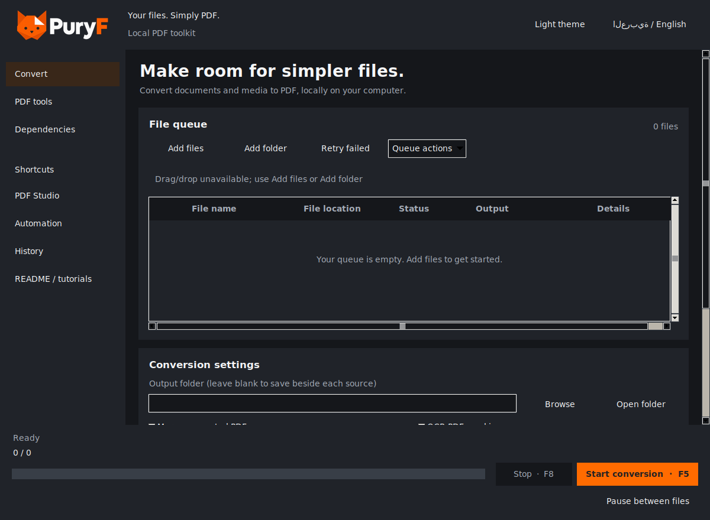
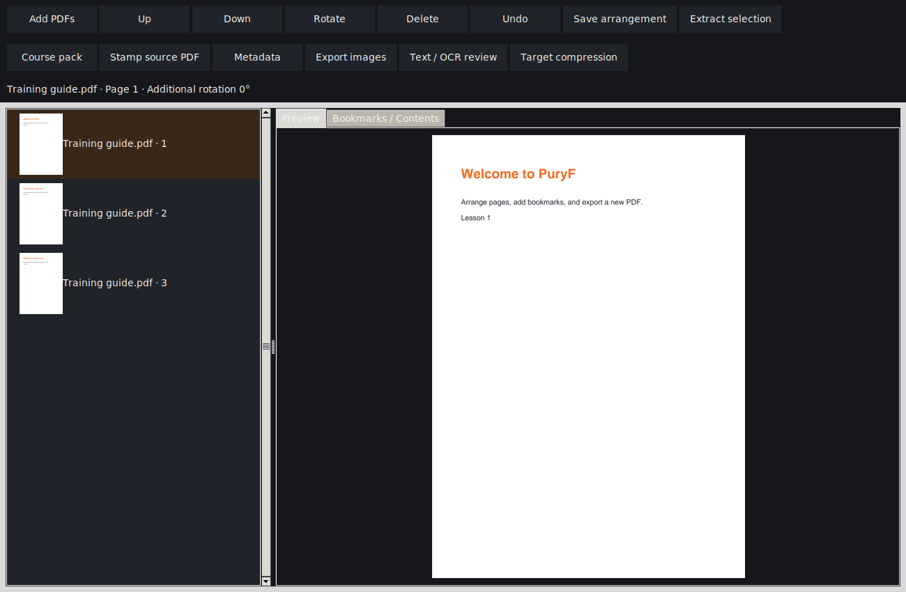
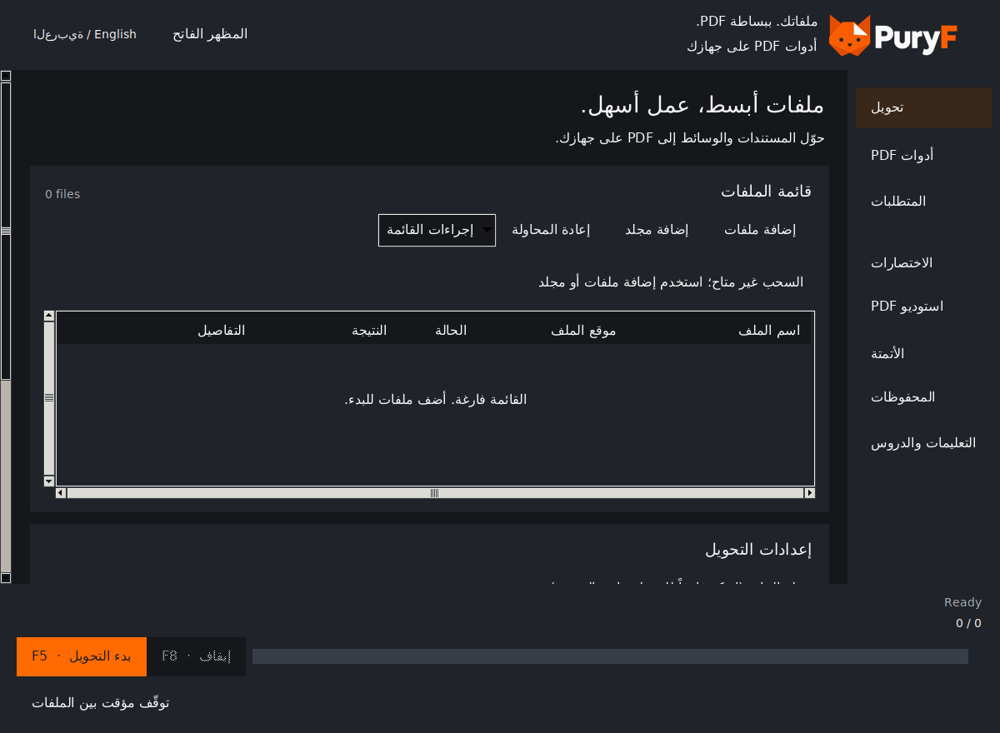

<p align="center">
  
</p>

<h1 align="center">PuryF</h1>

**Your files. Simply PDF.** Local conversion, PDF Studio and automation with an orange cat.
Version: **1.0.0**. Dark mode is the default; light mode and an Arabic mirrored interface are available.

## Release status — read this first

This package is the **v1 Windows release candidate**. The native Windows standalone EXEs, standalone
installer, source installer and portable ZIP have been built and tested on Windows. The standalone
and portable packages passed their bundled core self-test; both installers passed install and
uninstall lifecycle checks. The bundled core check also passed with Python removed from `PATH`.
This is not a full clean-PC certification: verify the final downloads on a fresh Windows VM or
Windows Sandbox and complete the manual Windows checks before publishing a production release.
Do not describe the source installer as standalone.

The main download is **PuryF-v1-Setup.exe**.
The secondary portable download is **PuryF-v1-Windows-portable.zip**, containing `PuryF.exe`,
`PuryF-cli.exe`, the private runtime, licenses, assets, examples and a `portable.marker` file.
The source fallback is clearly named **PuryF-v1-Source-Setup.exe** and requires Python. SHA256
values for all release installers and the portable ZIP are in `release/SHA256SUMS.txt`.
No cloud service has been deployed or purchased. Hosted mode remains a developer preview.

## Publisher and credits

PuryF is published by **AlsherkawiMO**.

- Instagram: [@alsherkawiMO](https://instagram.com/alsherkawiMO)
- Copyright © 2026 AlsherkawiMO
- PuryF source code is released under the MIT License.
- Third-party components retain their own licenses and notices in `THIRD_PARTY_NOTICES.md` and
  the bundled license files.

## Screenshots







## Contents

1. [Installation and source use](#installation-and-source-use)
2. [Build standalone Windows distribution](#build-standalone-windows-distribution)
3. [Clean-PC verification and release](#clean-pc-verification-and-release)
4. [Desktop conversion tutorial](#desktop-conversion-tutorial)
5. [PDF Studio tutorials](#pdf-studio-tutorials)
6. [Presets, naming, history and diagnostics](#presets-naming-history-and-diagnostics)
7. [Watch folders, schedules and background queue](#watch-folders-schedules-and-background-queue)
8. [Python SDK and converter extensions](#python-sdk-and-converter-extensions)
9. [V1 command examples](#v1-command-examples)
10. [Arabic interface and OCR review](#arabic-interface-and-ocr-review)
11. [External converters and troubleshooting](#external-converters-and-troubleshooting)
12. Full CLI, Explorer, MCP/local API, hosted website and cost references follow below.

This README is the complete user guide. Smaller reference files remain for convenience; you do not
need them to follow the tutorials here. Native Windows/Office and public deployment limits are stated
explicitly. See TEST_REPORT.txt for evidence and remaining platform checks.

## Installation and source use

### Standalone installer — after a Windows build

1. Download the verified `PuryF-v1-Setup.exe`; run it as your normal Windows user.
2. Optionally select Explorer integration, the terminal command and a desktop shortcut.
3. Launch PuryF from Start. Python and core libraries are bundled; target-PC installation does not
   download them or need a separate Python installation.
4. External Office/OCR/media converters remain separate, as listed below.
5. For upgrades from the older Python-required source installer, uninstall that installation first,
   preserving Documents/PuryF, then install standalone v1. Standalone-to-standalone upgrades use the
   ownership marker and preserve integration preferences.
6. Uninstall with Windows Settings → Apps. Documents, output PDFs, the normal profile and externally
   configured server data are preserved. Do not store real user documents in application runtime,
   license or demo folders; those are installation-owned.

### Portable ZIP — after a Windows build

1. Extract the entire ZIP to a writable folder. Keep `_internal` and both EXEs together.
2. Double-click `PuryF.exe` for the GUI. Run `PuryF-cli.exe --help` for commands.
3. The included `portable.marker` directs local settings/history to `Data` beside the executable.
   Do not add this marker to a normal installed copy. Portable mode does not register Explorer/PATH.
4. To move the portable application, close all jobs and move the whole folder, including Data.
   Saved absolute source paths must still exist. Server config/data paths are explicitly configured
   and do not move automatically. Only one GUI window is reused per Windows user.
5. If the folder is read-only, set `PURYF_DATA_DIR` to a writable absolute path before launching.

### Source fallback — available in this source package

Install 64-bit Python 3.12 with Tkinter, pip, venv and the Python launcher. Run the clearly named
source setup in `release/` or install from the extracted source root:

```bat
py -3.12 -m venv .venv
.venv\Scripts\python.exe -m pip install -r requirements.txt
.venv\Scripts\python.exe PuryF.py
.venv\Scripts\python.exe -m puryf --help
```

`Start_PuryF.bat` prefers the private `.venv`. `Run_CLI.bat ...` runs console commands. The fallback
installer downloads dependencies into its private environment and therefore needs internet at setup.
Linux/macOS source users can use `python3 -m venv .venv` and `.venv/bin/python`; Tk must be installed.
For headless SDK/server use, `requirements-server.txt` excludes desktop DnD and Office integrations.

Default local profile: Documents/PuryF. `PURYF_DATA_DIR` overrides it. HTTP/MCP/automation directories
are chosen in their configuration. Local history retains at most 1,000 jobs; no passwords are saved.
Do not run different program versions against one profile/server data directory simultaneously.

## Build standalone Windows distribution

Build on **Windows**, using 64-bit Python 3.12 and NSIS installed. No GitHub account or PowerShell is
needed. PyInstaller must run on the target OS; Linux output is not a Windows EXE.

1. Extract this complete source folder to a path with enough temporary disk space.
2. Install Python 3.12 (Tk, pip, venv, launcher) and NSIS on the **build** machine.
3. Double-click **Build_Standalone_Windows.bat**. It creates a private `.build-venv`, installs core
   dependencies/PyInstaller, builds GUI + console applications, and runs a bundled-core smoke test.
4. It copies README, assets, templates, examples and collected third-party license texts, then creates:
   `release/PuryF-v1-Setup.exe`, `release/PuryF-v1-Windows-portable.zip`, `SHA256SUMS.txt`,
   `bundle-smoke.json` and `downloads.json` identifying the standalone installer as the main candidate.
5. If NSIS is missing, the build stops with instructions; it does not silently claim an installer exists.
6. Run the clean-PC checks below before publishing the two candidate downloads.

`PuryF.spec` includes Python, Tk/DnD, PDFium rendering, Pillow, ReportLab, pypdf, cryptography and
Arabic text support. The console EXE includes the existing CLI, background automation, MCP stdio and
optional local/hosted-preview API commands. A separate console executable preserves stdout framing.
The default build excludes optional RAW/HEIF/SVG/OpenCV libraries; add their requirements and adjust
the spec if building those optional routes. Installing Python packages elsewhere on a target PC does
not change a frozen bundle. Plugins needing extra libraries likewise require a custom build.

The build collects distribution license files and Python/Tcl notices. Verify the final Windows
bundle's THIRD_PARTY_LICENSES and PDFium notices before distributing. PuryF project code is MIT;
third-party components retain their own terms. DejaVu font copyright/license ships with the font.

## Clean-PC verification and release

Use a fresh Windows VM/Windows Sandbox or separate Windows PC **without Python installed**. A developer
machine with Python hidden from PATH is not proof of a clean-PC installation.

1. Copy the whole built PuryF folder or install the standalone candidate. Disconnect networking when
   testing the core, to prove no dependency download is required.
2. Run **Verify_Clean_PC.bat** from the built application folder. It limits PATH to Windows system
   locations, sets a temporary test profile and runs the bundled self-test. Remove a previous
   `%TEMP%\PuryF-v1-clean-report.json` before retrying; reports do not overwrite existing evidence.
3. The test checks text conversion, PDF rendering, image export, MCP initialization and authenticated
   loopback HTTP. It records OS, frozen status, version and executable hash. `--clean-pc` is an operator
   assertion that this is the fresh PC; the program cannot prove the machine has never had Python.
4. Open the GUI and test Studio thumbnails/reorder/rotation, metadata, course pack, text review, Arabic
   mirroring, scroll/shortcuts, minimum size and DPI scaling. Test install, upgrade and uninstall.
5. Test Explorer one/mixed selections, PATH commands from a new terminal, portable relocation,
   MCP client connection, server access restrictions and optional external converters separately.
6. Publish the verified standalone installer as main download, portable ZIP second and source archive
   separately. Keep SHA256 checksums and the clean-PC report. Do not publish an installer built from
   Linux ELF files or substitute the source installer when claiming standalone support.

This source preview contains build/test scripts, not a claim that these native checks have happened.

## Desktop conversion tutorial

1. Open PuryF. Use **Add files**, **Add folder**, drag/drop or clipboard paths. ZIP ingestion uses the
   existing extraction limits. The queue shows source, state, output and details.
2. Choose an output folder, or leave it empty to write beside each source. Existing outputs are skipped
   by default. Original PDFs saved beside their sources use `_processed.pdf` names.
3. Set optional merge, lossless compression, OCR or password controls. Use Advanced settings for image
   paper size, PowerPoint layout/date, Excel fit-to-width and OCR languages.
4. Select a **Preset** and **Apply preset** if useful. Original keeps full image resolution; Print caps
   image edges at 4,800 pixels, Balanced at 2,400, Small at 1,400 plus lossless PDF stream compression.
   These profiles affect image conversion; they are not promises to change Office export quality.
5. Click Start/F5. Stop/F8 cancels the active job. **Pause between files** lets the current conversion
   finish before stopping at the next input boundary; Resume continues. It does not freeze an active
   Office call, and PDF editing operations finish their current job. A paused host can retain its
   conversion lease, so other PuryF hosts may wait until resume/cancel.
6. Add further Explorer batches while work runs. Use the queue menu/shortcuts to select, reorder,
   retry, duplicate or remove items when editing is permitted. Queue-only Explorer additions do not start.
7. Enable **Completion notifications** for a bell and a short nonmodal completion popup while the GUI
   is running. This is not an always-installed Windows tray service.

Both dark and light themes are retained. The fixed progress/action bar remains visible while the
body, queue and logs scroll independently. Retry/existing-output behavior is always subject to the
safe no-overwrite default and protection of every source registered with the current service.

## PDF Studio tutorials

Choose **PDF Studio** to open the workspace immediately. Use **Add PDFs** inside Studio to select files; selected queue PDF results
can also open there. Encrypted sources prompt for passwords, kept only in the current dialog/job.
Thumbnails load lazily, with a bounded rendering pool; large previews fit the viewer. Source PDFs are
never edited in place. Output saves fail safely if the destination already exists or is a source.

### Preview, arrange, rotate, delete and extract

1. Add PDFs. Each row is a page with a thumbnail and source/page label. Select a row to preview.
2. Ctrl/Shift-select multiple pages. Use Up/Down to reorder, Rotate for clockwise 90° steps, or Delete
   to remove pages from the arrangement. Undo restores the previous arrangement edit.
3. Add further PDFs to arrange a mixed document visually before merging.
4. **Save arrangement** writes every remaining page in the shown order to a new PDF.
5. **Extract selection** writes just the selected rows in their displayed order.
6. The Bookmarks/Contents tab lists source bookmarks; selecting one jumps to its page if it remains
   in the arrangement. Saved documents also receive source-section bookmarks; retained source
   bookmarks are mapped to the selected pages, with flattened nesting in this v1 implementation.

### Course-pack workflow

1. Convert slides, handouts, Word notes and images to PDFs using the main queue/CLI.
2. Open all resulting PDFs in Studio. Arrange exactly the pages students should receive.
3. Choose **Course pack**, enter a course title and save a new PDF.
4. PuryF inserts contents pages, clickable section links, source-section bookmarks and page numbering.
   Section titles come from source filenames; rename files first for useful learner-facing titles.
5. Check the contents links and numbers in Preview/a PDF reader before sharing. Course packs do not
   copy source attachments or guarantee preservation of every interactive form feature.

### Watermarks, logo, page numbers, headers and footers

Select a page and choose **Stamp source PDF**. This operates on that page's **source PDF**; save a mixed
arrangement first, then open that saved PDF to stamp the complete result. Enter watermark/header/footer,
choose an optional PNG/JPEG logo and enable page numbers. Save to a new filename. Arabic strings are
shaped for ReportLab using the bundled Unicode font. Watermarks are visible overlays, not redaction.

### Metadata

Choose **Metadata** for the selected source. Edit Title, Author, Subject or Keywords, or choose
**Remove document metadata** to remove the document Info dictionary and document/page XMP entries.
Save a new PDF. This is not a guarantee to erase sensitive text, annotations, attachments, images or
forensic traces from the original file. Review content separately before sharing.

### Export PDF to PNG/JPEG

Choose **Export images**, enter `png` or `jpeg`, then choose an output folder. It exports the selected
source PDF's pages at 144 DPI, with a render pixel limit. Existing images are not overwritten.
The CLI document spec supports page ranges and 36–300 DPI. Rotation already present in the PDF is
rendered. For just arranged pages, save the arrangement first, then export that result.

### Extract text and review OCR, including Arabic

Choose **Text / OCR review** for the selected source. The dialog shows the selected page image beside
editable extracted Unicode text from the entire source. Correct mistakes and save UTF-8 text to a new
`.txt` file. This saves reviewed text; it does not silently rewrite the PDF's OCR layer.

For scans, first return to the main conversion screen, enable OCR, use `eng+ara`, convert to a new PDF,
then open the OCR result in Studio. Language packs and external OCR tools must be installed. Arabic
text is stored in logical Unicode order and the review editor is right-aligned; native Tk bidi/editing
behavior still needs checking on your Windows build. Image preview preserves the actual PDF appearance.

### Compress toward a target size

Choose **Target compression** and enter KiB. PuryF first tries lossless stream/object compression.
It only rasterizes if you explicitly allow the lossy attempt. Raster compression may remove selectable
text/vector detail; it attempts several resolution/JPEG settings and retains the smallest candidate.
The target is best effort, not guaranteed. Job output details contain target_bytes, actual_bytes and
`target_met`; inspect the output before sharing. Reaching the target can be impossible for some files.

## Presets, naming, history and diagnostics

- **Save preset** stores named validated conversion settings, without passwords. Applying a GUI preset
  clears the current protection toggle/password so you can re-enter them deliberately.
- **Naming / folders** supports `{stem}`, `{ext}`, `{index}`, `{parent}`, `{date}` and `{hash8}`. No path
  separators, format expressions or arbitrary Python evaluation are allowed. Add `.pdf` automatically.
- Example `{index}-{stem}` creates numbered names; `{stem}-{hash8}` distinguishes content changes.
  The index follows valid conversion processing order. Hashing reads the complete source file.
- To preserve folders, choose an output folder and a Source root containing every source, then enable
  **Preserve source folders**. Example `C:/Training/unit/notes.txt` under root `C:/Training` becomes
  `C:/PDFs/unit/notes.pdf`. An input outside the root fails instead of escaping the output directory.
- **Find duplicates** compares file bytes with SHA-256 and selects later matches for review. It does
  not automatically delete originals or claim visually identical documents have identical hashes.
- **Preflight** checks dependencies before starting. CLI preflight additionally reports duplicate
  groups and PDF encryption/page information. It is not a guarantee that every converter will succeed.
- **History** retains up to 1,000 local jobs. Refresh, select and Repeat selected. Existing outputs still
  skip/fail safely; change destination/settings for a fresh output. Protected outputs require a new job
  with the password re-entered; passwords/reviewed text are not stored for automatic replay.
- **Recent folders** opens recently used output directories. History/profile data is local and contains
  source/output paths; keep your profile private.
- **Diagnostics** exports a redacted JSON with app/OS/Python versions, module availability and state
  counts. It omits usernames, paths, filenames, document text, passwords and raw logs/errors.

## Watch folders, schedules and background queue

Use **Automation** to select a JSON config and start a headless background process. Pause/Resume/Stop
and Retry failed watches control the configured queue. It runs until stopped; it is not installed as
a Windows service, does not wake a sleeping PC, and requires the user's session for interactive Office.
Config/plugins/manifests are local trusted code/configuration; do not accept them from uploads.

Example `automation.json` (edit paths; watched folders must exist):

```json
{
  "state_dir": "C:/PuryF/automation-state",
  "poll_seconds": 2,
  "watches": [
    {
      "name": "training-inbox",
      "folder": "C:/Training/inbox",
      "output": "C:/Training/pdfs",
      "recursive": true,
      "preset": "Balanced"
    }
  ],
  "schedules": [
    {
      "name": "hourly-course-batch",
      "every_seconds": 3600,
      "request": "C:/PuryF-config/course-batch.json"
    }
  ]
}
```

```bat
puryf background --config C:\PuryF-config\automation.json
puryf background-control pause --state C:\PuryF\automation-state
puryf background-control resume --state C:\PuryF\automation-state
puryf background-control retry --state C:\PuryF\automation-state
puryf background-control stop --state C:\PuryF\automation-state
```

A watch waits for two unchanged size/mtime polls, hashes the file, and submits new/changed content.
It preserves relative folders and defaults to `{stem}-{hash8}` output names. Nested output folders are
excluded. A pending record interrupted by a crash is retried on restart; the no-overwrite policy still
protects already produced PDFs. A failed content version is not retried forever; use Retry/reset or
change the file. A long writer can remain unchanged between polls, so copy complete files/atomic-rename
into a watch folder rather than converting files an application is actively editing.

Schedules reserve one run per time bucket before submission; they do not replay every missed interval.
The current bucket can run immediately on startup. A crash after reservation does not guarantee a retry
of that slot; use a new/manual manifest run when needed. Scheduled manifests support convert/merge/split.
Use unique output naming or intentional overwrite policy for repeated jobs. Configure presets in the
same automation state directory with `puryf --state-dir ... preset ...`.

For Windows login startup, use Task Scheduler → Create Task → trigger At log on → action Start a program:
choose `PuryF-cli.exe` and arguments `background --config "C:\PuryF-config\automation.json"`.
Use the normal logged-in account and a stable absolute config path. Do not create duplicate startup
entries or run unattended Office jobs as a system service. This setup is manual and not enabled by install.

## Python SDK and converter extensions

From source, install the SDK locally: `py -3.12 -m pip install .`, or use the package from this source
root. This is not a promise that a public PyPI project has been published. A frozen EXE is not a Python
interpreter for importing arbitrary packages into another script.

```python
from puryf import Client

with Client(root="C:/PuryF/sdk-state") as client:
    job = client.convert(
        ["C:/Training/notes.txt", "C:/Training/image.png"],
        {"output_folder": "C:/PDFs", "naming_pattern": "{stem}-{hash8}"},
        preset="Balanced",
    )
    print(job.id)
    result = job.wait(300)
    print(result["status"], result["outputs"])
    # job.snapshot(), job.cancel(), client.pause(), client.resume()
```

Other methods: `client.merge(inputs, output)`, `client.split(source, output_dir=..., every_n=5)`,
`client.document(inputs, spec, password="")`, `client.doctor(inputs)`, `client.repeat(history_job_id)`.
Use `client.store.preset_names()`, `.preset(name)`, `.save_preset(name, options)` and `.history()`.
Close the client to release/flush its owned service. A client attached to an existing service does
not close that service. Desktop/Explorer use one window/service; separate hosts serialize jobs using
the per-user conversion lease, while retaining separate in-memory registries.

Document action example (zero-based source/page references):

```python
with Client(root="C:/PuryF/sdk-state") as client:
    result = client.document(
        ["C:/PDFs/slides.pdf", "C:/PDFs/handout.pdf"],
        {"action": "compose", "output": "C:/PDFs/course-pack.pdf",
         "course_pack": True, "title": "Network Fundamentals"},
    ).wait(300)
```

Extensions are **trusted Python code**, explicitly loaded from a selected `.py` file. They are never
loaded automatically from a document/watch input directory or hosted upload. A minimal extension:

```python
API_VERSION = 1
NAME = "My training format"
EXTENSIONS = [".lesson"]

def check_dependencies():
    return []  # return human-readable requirement strings if unavailable

def convert(source, output, settings, log, cancel):
    # output is a private staging path; do not rename/overwrite the source.
    from reportlab.pdfgen.canvas import Canvas
    if cancel.is_set():
        return
    canvas = Canvas(str(output))
    canvas.drawString(40, 760, source.read_text(encoding="utf-8")[:100])
    canvas.save()
```

Use Automation → Load trusted extension, `puryf --plugin C:\plugins\lesson.py convert ...`,
`from puryf.extensions import load; load(path)` in SDK code, or automation config `plugins`.
Registration cannot silently replace a built-in converter. Extensions must honor cancellation and
use only trusted source files. A plugin can execute arbitrary code under your OS account: it is not
sandboxed. The default frozen bundle cannot acquire new dependencies by installing a Python package
elsewhere; rebuild with additional trusted libraries when needed. API/MCP command startup refuses
CLI plugin flags; hosted allowlists remain restricted.

## V1 command examples

Use `puryf` when PATH is installed, `PuryF-cli.exe` in a portable folder, or `Run_CLI.bat` from source.

```bat
puryf convert C:\Training --recursive --preset Balanced --output-dir C:\PDFs
puryf convert C:\Training --recursive --output-dir C:\PDFs --preserve-folders --name "{index}-{stem}"
puryf inspect C:\PDFs\notes.pdf --json
puryf preflight C:\Training --recursive --json
puryf preset list --json
puryf preset save Training --options C:\PuryF-config\preset-options.json
puryf history --limit 20 --json
puryf history --repeat JOB_ID --json
puryf diagnostics --output C:\Support\PuryF-diagnostics.json
puryf document C:\PDFs\notes.pdf --spec C:\PuryF-config\edit.json --json
```

`document` actions use a separate JSON spec; output/logo paths are relative to the spec file's directory.
Sources are command arguments (or SDK arguments), not paths embedded in the page references.

```json
{
  "action": "compose",
  "output": "arranged.pdf",
  "pages": [
    {"source": 0, "page": 2, "rotation": 90},
    {"source": 0, "page": 0, "rotation": 0}
  ]
}
```

Other specs:

```json
{"action":"decorate","output":"stamped.pdf","watermark":"DRAFT","header":"Training","footer":"Internal","page_numbers":true,"logo":"logo.png"}
```
```json
{"action":"metadata","output":"clean.pdf","remove_metadata":true}
```
```json
{"action":"text","output":"notes.txt"}
```
```json
{"action":"export","output_dir":"page-images","format":"png","dpi":144,"pages":"1-3,7"}
```
```json
{"action":"compress","output":"smaller.pdf","target_bytes":1048576,"allow_raster":false}
```

`text` additionally accepts `reviewed_text` for explicit UTF-8 export. `metadata` accepts a string
key/value `metadata` object. `compose` accepts `course_pack`, `title` and `page_numbers`; omitting
`pages` uses every page of each source in order. Merge/split use the retained commands below.
The v1 document actions are GUI/CLI/SDK features; the existing MCP/REST tool surface remains the
implemented conversion/merge/split/capability/progress/results contract, not arbitrary document specs.

## Arabic interface and OCR review

Click **العربية / English** to switch. Main controls/menus are translated and grid/pack layouts mirror
for right-to-left navigation. Filenames, paths and extracted/edited document text are not reversed.
Some technical logs/errors, native OS dialogs, option identifiers and secondary prompts remain English.
The normal profile remembers language; the portable profile keeps its own preference.

Arabic rendering/editing still needs native Windows font/bidi checks. Do not convert logical Unicode
text to visually reversed text before saving it. The PDF page preview is the reference when reviewing
Arabic OCR. `eng+ara` requires both Tesseract language packs and the external OCR tools.

## External converters and troubleshooting

| Feature | Separate requirement |
| --- | --- |
| Word/Excel/PowerPoint/Visio/Publisher/Project | Installed matching Microsoft Office desktop application; pywin32 is bundled only by a Windows build |
| MSG | Installed Outlook desktop |
| HTML/MHT | Word desktop; URL shortcut files are unsupported |
| OCR | OCRmyPDF command, Tesseract, Ghostscript and matching language packs |
| Ebooks | Calibre `ebook-convert` on PATH |
| draw.io documents | draw.io desktop CLI on PATH |
| Audio transcripts | Whisper CLI, FFmpeg and downloaded local model |
| HEIF/RAW/SVG/video | Optional Python libraries/runtime dependencies; use source or rebuild a bundle including them |
| CAD | Not implemented; export PDF from your CAD program |

Start with `puryf doctor` and `puryf doctor FILE --json`. Install only the converters you need, then
open a new terminal/restart PuryF so it sees PATH changes. Dependencies are not silently downloaded
when you submit a document. Office features require your own licensed installation; PuryF does not
bundle Office. Core preview, PDF tools, text and ordinary raster images do not require Office.

For OCR, follow [OCRmyPDF's Windows installation guide](https://ocrmypdf.readthedocs.io/en/latest/installation.html),
install the language data and verify commands from the same terminal:

```bat
ocrmypdf --version
tesseract --version
tesseract --list-langs
puryf doctor C:\Training\scan.pdf --json
```

The generic doctor describes format readiness; selected OCR options are checked by the job's own
preflight. Seeing `ara` in `tesseract --list-langs` is necessary for Arabic OCR, not a guarantee of
recognition quality. The GUI disables OCR when its command is missing. Use Studio text review after OCR.

Common fixes:

- **Nothing scrolls:** test the body/queue/log independently; enable the log and resize. Fractional
  touchpad deltas are accumulated. Physical Windows touchpad/DPI behavior needs the native checklist.
- **Existing output:** choose a new output folder/name. A skipped file does not mean conversion ran.
- **Cannot meet compression target:** try an explicitly allowed lossy attempt or accept a larger file.
- **SDK/mcp import failure:** preserve the source `puryf/` folder or install the SDK; do not copy only one launcher.
- **Portable fails after copying EXE:** copy the entire folder, including `_internal`; keep a writable Data location.
- **Background watch not retrying:** inspect history, fix the converter/input and use background-control retry.
- **Server refuses startup:** choose a dedicated empty data directory and permitted roots; set random 32+ character
  token variables. One host owns each server data directory. Close old hosts before upgrade/uninstall.
- **Build failure:** keep the complete build log. Use native Windows/Python 3.12 x64/NSIS, not a Linux cross-build.
  Frozen self-test checks core libraries, not real Office/OCR tools or GUI/installer behavior.

The following complete reference sections cover the original CLI options, Explorer semantics,
MCP/API configuration and web integration/cost planning. Their safety/delivery limits remain applicable.


---

# PuryF command line — v1

During Windows setup, optionally select **Terminal puryf command on user PATH**.
Open a new Command Prompt or terminal afterwards. The component is off for new installs;
your selection is remembered on upgrades. The desktop and Explorer remain optional entry points.

```bat
puryf --help
puryf --version
puryf gui
puryf gui "C:\Training\notes.txt"
puryf gui --convert "C:\Training\slide.pptx"
puryf convert "C:\Training\notes.txt" "C:\Training\diagram.png"
puryf convert "C:\Training" --recursive --output-dir "C:\PDF output"
puryf merge first.pdf second.pdf --output combined.pdf
puryf split combined.pdf --pages "1-3,7" --output selected.pdf
puryf split combined.pdf --every 5 --output-dir parts
puryf doctor
puryf doctor slides.pptx
puryf doctor --all --json
puryf convert notes.txt --json
puryf request batch.json --json
```

Without the PATH component, use `Run_CLI.bat` in the extracted source folder, or
`python PuryF_CLI.py ...` / `python -m puryf ...` with the dependencies installed.
`Run_CLI.bat` uses the private `.venv` if present, otherwise the Python launcher.
`python -m puryf` must run from the source root (or have that root on PYTHONPATH).
`PuryF.py` remains the desktop/Explorer launcher; `PuryF_CLI.py` is the console launcher.
The source-based fallback installer requires Python 3.10+ and internet; the standalone installer bundles the core runtime.

A runnable source example is included: `puryf request examples/convert.request.json --json`.
It converts `examples/notes.txt` into `examples/pdf-output` without Office.

## Inputs, outputs and safety

`convert` accepts individual files and folders, and mixes them in one job. A folder
scans its immediate files by default; `--recursive` scans subfolders too. Folder results
are sorted by name and duplicate resolved paths collapse. Directory symlinks below a
selected root are not followed. A nested output folder is excluded from the scan. The
scan is snapshotted before conversion, so new PDFs cannot re-enter that running job.

Folder scans skip unsupported extensions, ZIP, CAD, `.url` shortcuts and Office `~$`
files. The JSON scan result counts ignored files and records directory traversal errors.
Explicit unsupported/missing filenames become per-item errors; valid batch items continue.
An empty scan is a usage error. Existing PDFs in an input folder are included, so use a
separate output folder for repeatable source-folder conversion. Shell wildcard expansion
is not implemented; pass files, folders or a request file instead.

Outputs save beside each input unless `--output-dir` is given. PDF inputs save as
`name_processed.pdf` when writing beside the source. Names/format collisions and known
job-source paths use the existing engine safeguards. Existing outputs skip by default;
`--overwrite` permits replacing output files, while registered job sources remain protected.
Folder structure is not reproduced beneath the output folder; the existing collision
naming rules keep same-stem inputs distinct within the job.

Merge preserves the supplied PDF order. Page ranges are 1-based inclusive, e.g. `1-3,7`;
interval splitting uses `--every N` and names outputs with their page ranges. Sources
are not edited. Encrypted PDF inputs for merge/split can use `--input-password-env NAME`
(one password for the selected inputs). Conversion of already encrypted PDFs does not
prompt for a source password; use an unlocked source or the PDF-tool commands instead.

## Options

`convert` supports:

- `-o/--output-dir FOLDER`, `-r/--recursive`, `--overwrite`.
- `--merge` to also create a merged PDF, `--compress`, `--ocr`, `--ocr-language eng`.
- `--image-paper "Original size"|A4|Letter`, `--excel-fit-width`.
- `--ppt-layout NAME`, `--ppt-date-mode NAME`, `--timeout SECONDS` (external commands, default 900).
- `--password-env NAME` to encrypt outputs using a nonempty environment variable.

PowerPoint layout names: `Full-page slides`, `1 slide per page handout`,
`2 slides per page handout`, `3 slides per page handout`, `4 slides per page handout`,
`6 slides per page handout`, `9 slides per page handout`, `Speaker notes under each slide`.
Date modes: `Remove date`, `Keep existing date`, `Add today's date`.

Merge/split support `--overwrite`, `--password-env NAME` and `--input-password-env NAME`.
They do not accept conversion post-processing flags. No raw password command-line option
is provided. Password values stay out of JSON results and job snapshots. Request files
also refer to environment variable names rather than storing passwords. Set/clear those
variables using your shell's normal environment tools; inherited variables are visible
to processes with the same user privileges.

`--json` and `--quiet` can appear before or after the subcommand. JSON prints one
versioned document on stdout and suppresses normal progress. Human progress is printed
as lines on stderr; result paths and the summary are printed on stdout. Quiet suppresses
progress and human summaries; validation errors still go to stderr. Help/version remain
plain text even when `--json` is supplied. Paths needing shell quoting must be quoted;
for unusual characters or very long lists, use a request file.

## JSON request files

A request avoids Windows aggregate command-line length limits. Files are UTF-8 (BOM
accepted), limited to 16 MiB and 100,000 explicit input paths. Paths, including output
folders, are relative to the request file's own directory unless absolute.
There is no arbitrary command execution, nested request inclusion or GUI request mode.
Unknown fields, invalid option names/types, raw password fields and unsupported versions
are rejected before submission.

```json
{
  "version": 1,
  "command": "convert",
  "inputs": ["course notes.txt", "slides.pptx", "images"],
  "recursive": true,
  "options": {
    "output_folder": "pdf-output",
    "overwrite": false,
    "image_paper": "A4",
    "merge_pdf": false,
    "compress_pdf": false,
    "ocr_pdf": false
  }
}
```

`options` accepts the shared `ConversionOptions` fields except `password_pdf` and
`pdf_password`; use top-level `password_env` instead. In addition to base fields
`version`, `command`, `inputs`, each command accepts:

| Command | Extra request fields |
| --- | --- |
| convert | recursive, options, password_env |
| merge | output, options, password_env, input_password_env |
| split | output + pages **or** output_dir + every; options, password_env, input_password_env |
| doctor | recursive, all |

A merge request needs an `output` filename. A split request needs one input and exactly
one output mode. `options.output_folder`, merge/compress/OCR flags are not accepted by
merge/split. Partial or invalid filesystem scans are reported; complete conversions with
scan errors still return a partial-success code.

## Results and exit codes

JSON has `schema_version: 1`, `command`, and `exit_code`. Conversion/PDF-tool results
contain the existing `result` job snapshot plus `scan`: job ID, accepted public options,
progress, per-input status/output/error, output list, logs, cancellation and report path.
Doctor has a `doctor` report. Validation/runtime failures contain an `error` object.
GUI reports `launch_requested` and a launcher PID, not a guarantee of display availability.

| Code | Meaning |
| --- | --- |
| 0 | All requested work succeeded; doctor ready; or GUI launch requested |
| 1 | Conversion/PDF/I/O failure with no completed outputs |
| 2 | Invalid syntax, request, options, split mode, or no supported inputs |
| 3 | Doctor found missing requirements / invalid selected sources; or all job failures are dependency errors |
| 4 | Partial work: some outputs succeeded but files failed/skipped, or directory scan errors occurred |
| 5 | All conversion inputs skipped because their outputs already exist |
| 70 | Unexpected internal failure |
| 130 | Interrupted/cancelled |

The underlying job can say `succeeded` when some items were safely skipped; the CLI
still returns 4 if other items succeeded, or 5 when everything skipped. Always inspect
per-item results when automation needs precise handling. Interval splits can retain
completed parts after a later failure or cancellation.

Press Ctrl+C to request cancellation and wait for cleanup. External commands cancel;
an active synchronous Office call must return first. A cancelled JSON command still
returns its job snapshot where available. Force-killing a process cannot guarantee
cleanup of its external Office application.

## Diagnostics and coordination

`doctor` checks core modules and reports requirements by supported format. Optional
missing converters do not fail a basic doctor run. Selected inputs are preflighted;
`--all` requires every implemented format capability. CAD/URL and ZIP conversion are
excluded. Office diagnostics check registration and pywin32, not whether actual documents
render successfully. GUI diagnostics check module availability, not display connectivity.
No Office instance is launched by doctor.

Headless CLI commands do not import Tk and do not open a desktop window. Each CLI
invocation has its own in-memory job registry/FIFO, using the same `ConversionService`
and one Office-owning worker. GUI/Explorer share the existing single desktop window.
A shared per-user conversion lease under `%LOCALAPPDATA%\PuryF\Conversion` now serializes
whole jobs across these processes: only one host converts at a time. Waiting is
cancellable; OS locks release after a process exits/crashes. This is mutual exclusion,
not a global FIFO/job broker or a shared history database. `puryf gui` hands files to
the GUI queue; ordinary `convert` results stay in the invoking terminal. Source guards
cover each host's registered jobs; do not opt into overwrite when another process has
queued that destination as an input. Versions before 0.4 do not honor the new lease.

## PATH component and lifecycle

The optional command is a small `bin\puryf.cmd` wrapper around the installed private
Python console interpreter. Only the dedicated `bin` directory is added to **user**
PATH. Raw registry strings, expandable references, value types, delimiters and unrelated
entries are preserved. A pre-existing entry is not claimed or removed. Upgrades retain
the component choice; deselecting it removes PuryF's owned entry and wrapper. Uninstall
removes only its owned entry and leaves other applications' PATH entries intact.

The helper writes `HKCU\Environment` and broadcasts the environment-change notification.
It does not run PowerShell or `setx`. Open a new terminal; an already-running terminal
or terminal host may need to be restarted before child shells inherit the new PATH.
References: [WM_SETTINGCHANGE](https://learn.microsoft.com/en-us/windows/win32/winmsg/wm-settingchange),
[setx limitations](https://learn.microsoft.com/en-us/windows-server/administration/windows-commands/setx).

Native Windows command forwarding, Ctrl+C, PATH/registry notifications, upgrade and
uninstall still require target-PC validation. The installer is unsigned and compiled,
not executed on Windows in this development environment. Native Windows standalone build/clean-PC verification,
Stdio MCP and optional HTTP gateways are now included; see MCP_API.md and HOSTING.md.

## Long-running integration commands

`puryf mcp --config FILE` starts stdio MCP; `puryf serve --config FILE` starts the loopback HTTP API.
Omit `--json`: these commands own their transport output. Neither starts automatically. Read
MCP_API.md before selecting folders/keys; hosted deployment limits and costs are in HOSTING.md.


---

# Windows Explorer integration — v1

Choose **Explorer right-click actions (classic menu)** in the installer's Components
screen. It is off for new installations and remembered on upgrades. No administrator
access is needed. On Windows 11 use **Show more options** to reach the classic menu;
a native modern Windows 11 extension is a later milestone.

| Action | Behavior |
| --- | --- |
| Convert to PDF with PuryF | Open/reuse the desktop window and submit the selected supported files immediately. |
| Add to PuryF queue | Open/reuse the window and add files as Queued; do not submit a job. Press Start when ready. |
| Open PuryF from Start menu | Bring the existing window forward, or create it if none is running. Windows may restrict foreground focus. |

Select one file or mixed formats. The two actions appear for all files so mixed
selections share the same verbs. Unsupported/missing files, Office temporary files,
folders, ZIPs, CAD and `.url` shortcuts are skipped with activity-log messages.
Use the desktop's folder/ZIP import for those supported ingestion operations.
Unavailable conversion dependencies become per-file job errors; other valid inputs continue.

## Explorer defaults

These settings do not inherit the last desktop output folder, password or other toggles.
Queue-only files use the GUI settings when you later press Start.

| Setting | Explorer conversion value |
| --- | --- |
| Destination | Beside each source file |
| Name | Source stem + `.pdf`; PDF inputs use `_processed.pdf`; existing collision/source guards apply |
| Existing output | Skip with a visible item error; never overwrite |
| Merge / compression / OCR / password | Off |
| Images | Original size |
| PowerPoint | Full-page slides; Remove date |
| Excel fit-to-width | Off |
| External command timeout | 900 seconds |

No dialog is required to submit a batch. Results, dependency errors, progress and
reports appear in the existing desktop UI. Stop cancels the active job; queued jobs
retain the shared service's normal behavior. Closing cancels all submitted jobs.
Files added with the queue action remain waiting even after earlier jobs finish.
A queued source explicitly passed to Convert is submitted; sources already in active
or pending jobs are not submitted again. Completed sources may be explicitly retried,
subject to the no-overwrite default. Duplicate paths within one incoming batch collapse.

## One window and additional batches

`PuryF.py` is the entry point for all shortcuts and installed context-menu commands.
A short launcher publishes an atomic JSON request under
`%LOCALAPPDATA%\PuryF\Explorer\pending`, then tries a per-user file lock. The winning
process creates the desktop; other launchers wait for acknowledgement and exit.
The lock is released by the OS if its owner crashes. A forwarding process can become
the new owner if the previous window closes before accepting its request.

The desktop polls on its Tk thread. Adjacent requests with the same action are combined
into bounded batches, in publication order; Explorer's original selection order is not
guaranteed. This handles legacy Explorer's separate per-file launches without opening
separate windows. Different clicks can become one job, or a large selection can become
several jobs, depending on arrival times. All jobs use the same FIFO/Office worker.
Incoming batches are accepted while conversion is running; queue-only rows never start
automatically. The publisher imports neither Tk nor conversion libraries.

The mailbox is local IPC for the current OS user. It has no network listener or remote
credentials and does not support other users/machines. Requests accept only a version,
action and absolute paths; settings and executable commands are not accepted. Requests
are limited to 1 MiB and 2,000 paths; each tick reads at most 100 request files. Filesystem
permissions inherit the user's local app-data directory. This trusts processes already
running as that user, like the desktop application itself.

Acknowledgement happens after queueing/submission. Unacknowledged requests survive a
crash/closing window and are retried on the next launch. Delivery is at least once,
not a durable exactly-once job system; a crash between submission and acknowledgement
can retry a request. Source/no-overwrite guards remain in force. Malformed requests are
rejected and removed with a log entry. A handoff that cannot be accepted in 60 seconds
shows an error and leaves the request available for the next launch. A `.tmp` file left
by an interrupted publisher is never processed.

## Registration, upgrades and removal

The installer owns only these two per-user keys:

- `HKCU\Software\Classes\*\shell\PuryF.Convert`
- `HKCU\Software\Classes\*\shell\PuryF.Queue`

Both set `MultiSelectModel=Player` and a quoted direct `pythonw.exe` command with
`--explorer-convert -- "%1"` or `--explorer-queue -- "%1"`. No `cmd.exe`, PowerShell,
file association changes or default-open changes are involved. `--` protects paths
beginning with option-like names. Every file gets its own lossless JSON handoff, avoiding
an aggregate command-line length limit.

Upgrades retain the chosen component, refresh commands for the installed location,
and remove this installation's old verbs if the component is deselected. Uninstall
checks each verb's `PuryFOwner` before deleting it and sends an association-change
notification. It also removes transport-owned pending requests, temporary request files
and the lock file; source documents, outputs, reports and saved GUI session are kept.
Use one installed location per user; upgrade in place. The desktop and cross-process conversion locks are checked
before setup/uninstall. Close legacy releases too: versions before 0.3 do not hold that
lock and cannot be detected by it.

Microsoft documents a **100-item legacy Player limit**. Above that, these verbs may not
appear. Use desktop import for larger batches. We do not change Explorer's global
selection limits. A native selection-aware COM extension can be considered with the
modern menu work:
[verb selection model](https://learn.microsoft.com/en-us/windows/win32/shell/how-to-employ-the-verb-selection-model),
[verb command quoting](https://learn.microsoft.com/en-us/windows/win32/shell/fa-verbs).

## Validation status

Automated checks exercise real multi-process launch handoffs, owner death/recovery,
Unicode/space/shell-character paths, mixed real text/image conversions, queue-only
behavior, busy-worker arrivals, fixed defaults, duplicate handling and dependency errors.
The installer is compiled with NSIS. These tests run on Linux with Tk 8.6 and Tk 9.
Actual Explorer invocation, Windows `msvcrt` locks, registry writes, installation,
upgrade/deselection and uninstall must still be validated on Windows using
[WINDOWS_CHECKLIST.txt](WINDOWS_CHECKLIST.txt). Office is tested with a lifecycle mock,
not an installed Microsoft Office application. This is a source preview; Windows release validation is pending.

CLI commands are now available; see CLI.md. Conversion workers also acquire a per-user
lease, so concurrent headless CLI jobs wait while a desktop/Explorer conversion runs.


---

# MCP and local API — v1

This release adds a local stdio MCP server, an optional loopback HTTP API, and a
hosted-workflow preview. None starts automatically. Desktop, Explorer and CLI
remain available. The server uses the existing conversion service and per-user
conversion lease; it does not require Tk for headless work.

## Setup

Copy a JSON example from `integration-configs/`, edit the paths, and keep it outside
the source tree when upgrading. Every data directory must be absolute, dedicated,
initially empty, and private to the server OS account. Do not point it at Documents
or another project. One integration host owns each data directory. Windows examples
contain YOUR_NAME placeholders; Linux/macOS users must replace them with native paths.

Input folders must already exist. Local/MCP inputs require absolute regular-file
paths beneath `read_roots`. Linked files/directories and Windows junctions are
rejected. Missing roots deny startup; there is no implicit access to your whole PC.
Converted PDFs are written under the configured data directory in unique job-owned
folders. Clients cannot select arbitrary output paths or enable overwrite.

Use the installed `puryf` command when its PATH component was selected, or use
`python -m puryf ...` / `Run_CLI.bat ...` from the source root. For a headless source
installation, install `requirements-server.txt` instead of desktop dependencies.
The Windows source installer still requires Tk because it includes the desktop.

## MCP: local stdio first

```bat
puryf mcp --config "C:\PuryF-config\mcp.json"
```

Set `mode` to `mcp`. No HTTP key or port is required: the client launches a local
child process, and folder permissions come from your administrator-edited config.
Use a dedicated data directory distinct from a running API's directory.

Example client configuration (adapt the outer `mcpServers` format to your MCP client):

```json
{
  "mcpServers": {
    "puryf": {
      "command": "C:/Users/YOUR_NAME/AppData/Local/Programs/PuryF/PuryF-cli.exe",
      "args": [
        "mcp", "--config", "C:/PuryF-config/mcp.json"
      ]
    }
  }
}
```

| Tool | Purpose |
| --- | --- |
| puryf_convert | Convert permitted local files; returns a background job ID |
| puryf_merge | Merge PDF inputs in order |
| puryf_split | Extract `pages` or split `every` N pages; one input |
| puryf_dependencies | Preflight selected permitted files |
| puryf_capabilities | Formats, readiness and configured limits |
| puryf_job_status | Poll progress, state, errors and output metadata |
| puryf_cancel | Request job cancellation |
| puryf_results | Verified absolute output PDF paths for completed jobs |

Submission tools return promptly. Poll status using the returned job ID; progress is
job progress, not an unsolicited notification after a completed MCP request. Cancel
jobs explicitly through `puryf_cancel`. Cancelling an already-completed MCP request
cannot undo a submitted job. An active synchronous Office call must return before
cancellation completes. Closing stdin cancels/cleans up jobs and shuts down the host.

Newline-delimited JSON-RPC stdout contains protocol messages only; diagnostics go to
stderr. Incoming messages are capped at 1 MiB; oversized messages terminate the stream.
Supported protocol eras:

- `2026-07-28`: `server/discover` and per-request protocol-version `_meta`; complete
  tool results include `resultType`. No initialization handshake is required.
- `2025-11-25`, `2025-06-18`, `2025-03-26`: initialize/initialized legacy handshake.

Unknown modern versions return `-32022` with supported versions. Unknown methods and
invalid tool names return JSON-RPC errors; tool execution failures use `isError`.
There are no advertised prompts/resources/subscriptions. Standard-stream request
cancellation is not a substitute for the explicit asynchronous job-cancel tool.
**Streamable HTTP MCP is intentionally deferred**; the REST API is not an MCP transport.

References: [MCP stdio transport](https://github.com/modelcontextprotocol/modelcontextprotocol/blob/main/docs/specification/2026-07-28/basic/transports/stdio.mdx),
[MCP schema](https://github.com/modelcontextprotocol/modelcontextprotocol/blob/main/schema/2026-07-28/schema.json).
Wire behavior has automated tests; connecting real third-party MCP clients is a remaining
compatibility check. No client settings are changed by the installer.

## Local HTTP API

Copy `local.example.json`, set `mode: local`, permitted roots and a private data folder.
Create a random token, then set its referenced environment variable in the terminal
that starts the server. Example using Command Prompt, without PowerShell:

```bat
py -3 -c "import secrets; print(secrets.token_urlsafe(32))"
set "PURYF_LOCAL_TOKEN=PASTE_THE_GENERATED_TOKEN_HERE"
puryf serve --config "C:\PuryF-config\local.json"
```

Use at least 32 characters; placeholder/empty keys refuse startup. One account is
allowed in local mode. HTTP authentication uses `Authorization: Bearer YOUR_TOKEN`.
Tokens are not accepted in query parameters. Your MCP client/HTTP caller may retain its own request traces; avoid sharing password-bearing traces. The server binds **127.0.0.1 only**;
there is no automatic firewall rule, LAN listener, system service or startup task.
Never put real keys in an example config or website source. Rotate a key by changing
its environment variable and restarting the server; use separate keys per customer
in hosted mode.

`curl.exe` example (CMD expands the environment variable):

```bat
curl.exe -H "Authorization: Bearer %PURYF_LOCAL_TOKEN%" http://127.0.0.1:8765/v1/capabilities
```

A local submission JSON body:

```json
{
  "operation": "convert",
  "inputs": ["C:/Users/YOUR_NAME/Documents/Conversion-inputs/notes.txt"],
  "options": {"compress_pdf": false}
}
```

Submit with `Content-Type: application/json` to `POST /v1/jobs`; response 202 contains
`job.id`. Supply an `Idempotency-Key` of 8–128 ASCII letters/digits/`._:-` when retrying
submission. Identical request/key/account replays the same job (200), including after
a restart. A different request with that key returns 409. Omit the header to submit a
new job. Key records expire with job retention, so reuse after expiry can create new work.

## Endpoint contract

[openapi.json](openapi.json) describes the routes; all `/v1` endpoints require a token.
JSON bodies are limited to 128 KiB. Files use a separate bounded binary upload.

| Method and path | Result |
| --- | --- |
| GET /v1/capabilities | Enabled formats, dependency readiness and global limits |
| POST /v1/dependencies | Preflight `{ "inputs": [...] }` |
| POST /v1/uploads?name=notes.txt | Hosted-only raw file body; returns upload ID (201) |
| POST /v1/jobs | Submit convert/merge/split job (202), or idempotent replay (200) |
| GET /v1/jobs/ID | Status, progress, per-input states, outputs, safe errors |
| GET /v1/jobs/ID/results | Same current job/result snapshot |
| POST /v1/jobs/ID/cancel | Body `{}`; request cancellation |
| GET /v1/jobs/ID/files/INDEX | Authenticated individual PDF, after job is terminal |
| GET /v1/jobs/ID/archive | Authenticated ZIP of available outputs |
| POST /v1/jobs/ID/links | Mint a temporary individual/ZIP link |
| GET /d/GRANT | Download with a signed expiring bearer grant; no API key required |

Submissions accept `operation`, `inputs`, optional `options`, `input_password`,
`output_password`, and `webhook_id`. Split additionally requires exactly one of
`pages: "1-3,7"` or `every: 5`. Merge/split accept PDF inputs only. Source passwords
apply to merge/split; output passwords enable AES protection. Passwords never enter
public snapshots or persisted raw requests. The idempotency fingerprint is HMAC-protected.
`options` uses ConversionOptions but prohibits output_folder, overwrite, password_pdf
and pdf_password. PDF-tool jobs reject conversion merge/compression/OCR flags. Hosted
OCR is disabled. All outputs are managed files, and sources remain protected.

Snapshots use public job IDs, input/output names and asset indices. They omit server
paths, raw converter logs, reports and detailed converter errors. MCP's results tool
can return local paths because it runs under the same local folder policy. Errors
include stable codes; use local administrative diagnostics for debugging sensitive files.

HTTP error classes: 400 invalid request, 401 bad/missing key, 403 folder/Host/Origin
restriction, 404 unknown or cross-account object, 409 idempotency/not-finished conflict,
410 expired job/file, 411 missing length, 413 body limit, 415 content type,
422 disabled route/bad document, 429 usage limit. Token authentication applies before
job lookup, and tenant checks apply to uploads, jobs, cancellation, downloads and link creation.

Uploads require a single Content-Length; chunked request bodies are rejected. The
server bounds concurrent connections and timeouts. Origin headers require an exact
`allowed_origins` match; defaults deny browser origins. Host headers must match the
loopback listener or configured `allowed_hosts`. These controls complement tokens,
not replace them. CORS does not bypass authentication. Responses are `no-store`.

## Limits, persistence and cleanup

Defaults: 20 inputs/job, 10 MiB/file, 4 active jobs/customer, 100 jobs/rolling 24 hours,
500 MiB of uploads/job files/customer, 120 authenticated requests/minute. Upload count
is also capped to jobs/day × max_files/day. Limits are per account and configurable.
PDF uploads cap unencrypted page counts at 1,000; encrypted PDFs are checked after
unlock for PDF-tool jobs. Images cap dimensions at 40 million pixels and 1,000 frames.
These are application limits, not a hostile-document sandbox or guaranteed CPU bound.

Job deadlines request cancellation after the configured interval (default 900 seconds).
The engine may need to return from an in-process/Office call first. Output storage is
checked at completion; quota-exceeding job outputs are removed and the job fails safely.
ZIP creation requires space for an additional output copy. Reports are private server
files and are swept separately; metadata/filesystem overhead also needs disk headroom.

SQLite stores ownership, public snapshots, request fingerprints, usage counters and
webhook delivery state. It does not persist passwords. Completed results and idempotency
survive restart. Interrupted/reserved jobs become `server_restarted` failures instead of
being automatically repeated. A transactional durable multi-worker queue is later work.

Retention defaults to 24 hours, configurable from 60 seconds to 7 days. Expired jobs,
outputs, ZIPs and unreferenced uploads are deleted automatically. Active jobs pin their
uploads until completion/cancellation. Crashed unregistered upload/work folders and old
reports are swept after retention. Usage counters retain 7 days of counts. Terminal
service jobs are forgotten to bound memory. SQLite backups/WAL/free pages may retain
deleted metadata; this is logical cleanup, not forensic secure erasure. The OS owner
must manage backups and storage-level retention. Do not modify managed directories
while the server is running.

## Completion webhooks

Only administrator-configured HTTPS presets can be selected, and each preset belongs
to one account. Add an object like `webhook.example.json` under config `webhooks`, set
the referenced signing-secret environment variable, and submit `webhook_id` with a job.
Client-supplied callback URLs are rejected. Preset URLs and their DNS/egress destinations
are administrator-trusted; use an outbound network allowlist when deploying.

Completion payload: `{ "event": "job.completed", "job": PUBLIC_SNAPSHOT }`.
Headers: `X-PuryF-Delivery` is the public job ID; `X-PuryF-Timestamp` is Unix seconds;
`X-PuryF-Signature` is `sha256=HMAC_SHA256(secret, timestamp + "." + raw_body)`.
Verify before parsing, require a fresh timestamp (for example ±5 minutes), and deduplicate
delivery IDs in your receiving database. No API keys or automatic download grants are sent.
Fetch results using your key or deliberately mint a temporary link.

Delivery runs on its own bounded worker, with a five-second request timeout, no redirects,
and up to five attempts with exponential delays. State survives restart; in-flight
attempts are retried. Shutdown bounds its wait for a slow callback; an unfinished claimed delivery remains recoverable. Delivery is at least once, so receivers must tolerate duplicates.
External receiver availability and egress must be tested on the deployment network.

For public hosting, website integration and cost planning, see [HOSTING.md](HOSTING.md).


---

# Hosted API and website plan — v1

The upload-to-download workflow is implemented and tested on a loopback server. This
is a **single-host developer preview**, not a public multi-tenant production service.
No hosting, domain, storage account or paid resource has been created.

## Implemented now

- Single-file binary uploads and multi-file selection/upload followed by one bulk job.
- Background conversion/merge/split, public job IDs and polling progress.
- Individual PDFs, ZIP downloads and expiring signed download grants.
- Administrator-owned customer API keys, logical tenant ownership and quotas.
- Atomic idempotency reservations, persistent completed results and restart failure handling.
- Automatic upload/output/ZIP cleanup; active-job input preservation.
- Signed completion webhooks with durable retry state and account-scoped presets.
- Conservative server-side format validation and explicit Office rejection.
- A browser integration demo, Python backend/automation client, OpenAPI reference,
  configuration templates and reference container files.

## Run the hosted workflow locally

Copy `integration-configs/hosted.example.json`; edit `data_dir` to an absolute private
empty directory on your machine. Windows users must replace `/var/lib/puryf/data` with
a native path. Set the account's environment variable to a generated 32+ character key.
For a local demo, keep allowed origin `http://localhost:8080`. Start:

```bat
puryf serve --config "C:\PuryF-config\hosted-preview.json"
```

In another terminal, from the extracted source root:

```bat
py -3 -m http.server 8080 --bind 127.0.0.1 --directory website
```

Open `http://localhost:8080/`. Enter `http://127.0.0.1:8765` and your own
customer token, select one or several files, and convert. The page shows per-file
upload progress, job progress, cancellation, individual downloads, a ZIP and a
five-minute ZIP link. It keeps the key only in page memory and loads no third-party
scripts. Serve only this website folder; keep real configs, environment secrets and managed data outside the static file root. It is a developer demo, not a customer identity/login system.

`website/python_client.py` shows backend/automation integration. Set
`PURYF_CUSTOMER_TOKEN` and optional `PURYF_API_BASE`; then run:

```bat
py -3 website\python_client.py "C:\PDF-downloads" "C:\Training\notes.txt"
```

In hosted mode, `inputs` contains upload IDs, never server filesystem paths. Upload
files one at a time with `POST /v1/uploads?name=...` and a raw binary body, then submit
all IDs as one job. This avoids multipart parsing and aggregate command-line limits.
A partially failed bulk upload leaves its successful uploads available until retention;
it is not an atomic multi-file upload transaction.

## Office and route policy

Hosted allowlist: UTF-8 TXT/Markdown, common raster images, and PDFs. Content is parsed
and checked in addition to filename extension. CAD/URL/ZIP, HTML/SVG, ebooks, audio/video,
OCR and Office-dependent routes are rejected on this server. No fallback claims to have
rendered an Office document as text. Hosted `allow_office: true` is refused at startup.
Local MCP/API Office routes require explicit administrator opt-in and matching installed
Office/pywin32; they may still need interaction in the user's desktop session.

Microsoft advises against unattended server-side desktop Office automation because of
support/reliability problems. A future hosted Office backend must use a server-suitable
renderer or licensed service and pass DOCX/XLSX/PPTX fidelity tests: fonts, Arabic, page
breaks, print areas, slide notes, charts and embedded objects. Do not enable the existing
COM path in a web-service account. Source:
[Microsoft server-side Office considerations](https://support.microsoft.com/en-gb/visio/considerations-for-server-side-automation-of-office).

## Deployment boundary and next production work

The preview uses Python's standard-library HTTP server and in-process converters.
Python does not recommend `http.server` for production:
[official documentation](https://docs.python.org/3.12/library/http.server.html).
A TLS proxy alone does not turn this into a hardened public document-processing service.
Filesystem/account checks provide logical tenant segregation, not separate OS sandboxes.
Parser CPU/memory limits and cooperative cancellation do not contain arbitrary hostile files.

Before exposing unrestricted customer uploads, implement and validate:

1. A production HTTP frontend (ASGI/WSGI) with strict body/concurrency/time limits and
   a reverse proxy providing TLS, request limits and private upstream access.
2. A durable queue and per-job isolated worker/container with memory/CPU/disk/pid/time
   limits, no host mounts, no network egress, and a restricted service account.
   Keep webhook egress in a separate allowlisted dispatcher.
3. Real customer authentication/session handling, key provisioning/rotation/revocation,
   billing/admin workflow and an audited authorization boundary. Never ship one shared
   privileged key in public JavaScript. A website backend should map its authenticated
   customer to that customer's key/job ownership, without accepting spoofable owner IDs.
4. Object storage with tenant prefixes, private buckets, bounded signed URLs, lifecycle
   deletion, backups and retention policy; a transactional database for horizontal hosts.
5. Malware/parser abuse tests, dependency patching, load/fault tests and independent
   authorization testing. Validate physical deletion and capacity alerts.

Until then, run with trusted users/documents on a private machine or controlled staging
network. Current binding stays on 127.0.0.1. A user's API key is not an OS sandbox.
Modern Streamable HTTP MCP, resumable uploads, global multi-host FIFO and automatic
recovery/retry of unfinished conversion jobs remain later milestones.

## Reference container files

`deployment/Dockerfile` and `compose.example.yaml` are **unbuilt reference templates**
for Linux staging. Copy a real server config to `deployment/server.json` and create a
private `deployment/server.env` with only required key/signing variables. Do not commit
that file. Prepare `deployment/data` for UID/GID 10001. The container uses a read-only
root, a writable private data volume and bounded temporary storage. Its sample resource
budget is 2 CPUs, 4 GiB RAM and 64 PIDs; benchmark before choosing capacity.

The compose template uses Linux host networking so the API remains loopback-only behind
a host proxy. It is not a portable Windows/macOS Compose deployment. The resource limits
bound the whole server, not each customer/job; a worker-per-job sandbox is still needed.
Pin a tested base-image digest and dependency lock before deployment. This release does
not claim a successful Docker build or public TLS deployment.

Disable/redact reverse-proxy access logs for `/d/` bearer-grant paths, keep keys out of
logs, and use the application's no-store responses. Signed links can be used by anyone
holding them until expiry; expose that sharing choice intentionally. Account removal or
signing-key rotation revokes access, but deleting a downloaded copy is outside the server.

## Hosting/storage/operating-cost model

Start with your existing computer for local MCP/API: the software needs no paid API or
cloud subscription. Electricity, connectivity and optional Office licensing remain your
own costs. A public hosted service has resource/maintenance costs; this plan assumes no
unlimited free tier.

Estimate with measured values:

- CPU hours/month = jobs × mean processing seconds / 3,600.
- Average retained GB = daily jobs × mean (upload + outputs + requested ZIP) GB × retention days.
- Download GB/month = jobs × mean downloaded output GB × download/retry count.
- Peak disk = retained data + active job scratch + ZIP copies + logs/DB/backups + safety headroom.
- Monthly total = compute + storage + egress + backups + domain/TLS operations + monitoring
  + renderer licensing + maintenance time. Never count free transfer/storage allowances twice.

Illustrative sizing assumptions (not measured performance or live provider quotes):

| Scenario | Jobs/month | Mean processing | Input + output/job | Retention | CPU hours | Retained originals/results |
| --- | ---: | ---: | ---: | ---: | ---: | ---: |
| Small pilot | 1,000 | 5 s | 2 MB + 3 MB | 1 day | 1.39 | about 0.17 GB |
| Growing pilot | 10,000 | 10 s | 5 MB + 5 MB | 2 days | 27.78 | about 6.67 GB |

Using one output download/job gives about 3 GB and 50 GB/month respectively, before
ZIPs/retries. If every job also gets a ZIP, retained output bytes and download traffic
increase accordingly. Queues need peak-hour capacity, not just average CPU. OCR/video
would change these assumptions substantially and are not enabled here.

An example planning envelope might reserve USD 20–40 for compute, USD 5–10 for storage
and backups, USD 0–10 for egress, and USD 1–2 monthly equivalent for domain operations:
USD 26–62/month before labor/tax/licensing. These are budget placeholders, not prices,
provider recommendations or a commitment to spend. Obtain current quotes after measuring
real file sizes, conversion times, concurrency and transfer volume. No paid service has
been provisioned as part of this work.
